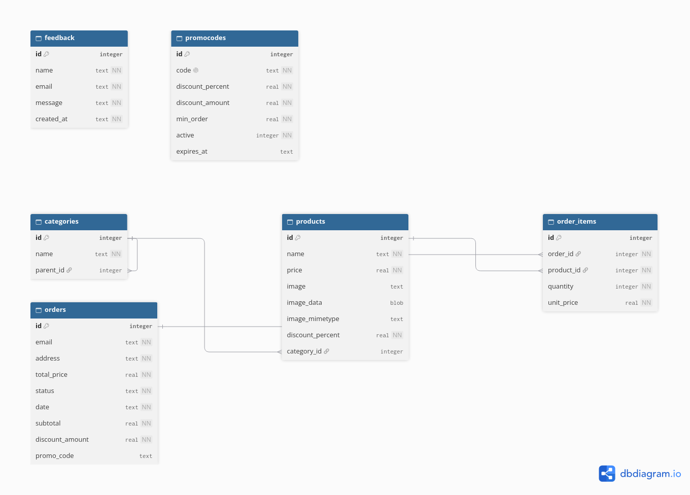
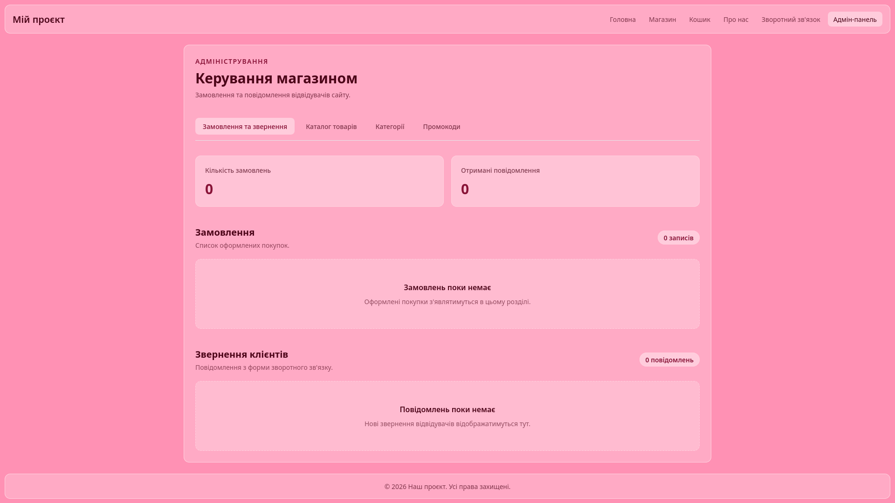
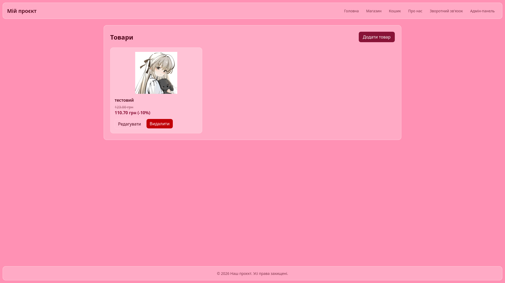
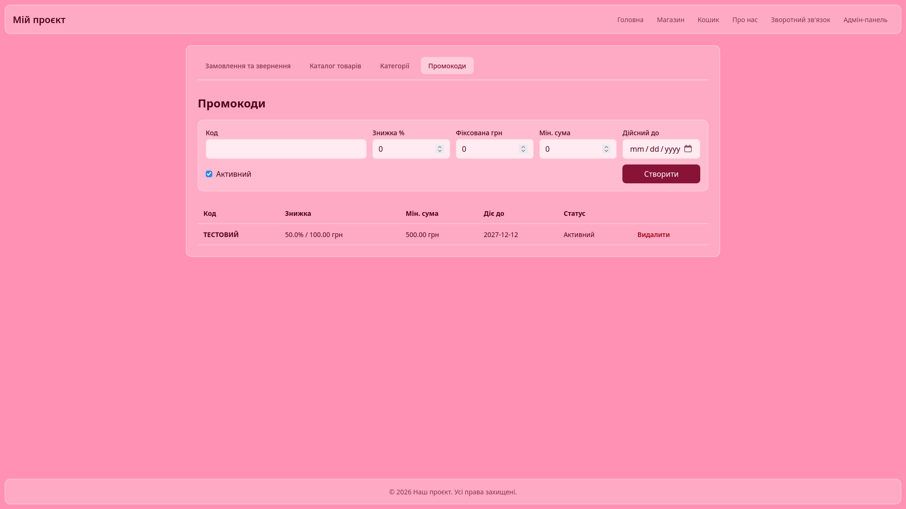
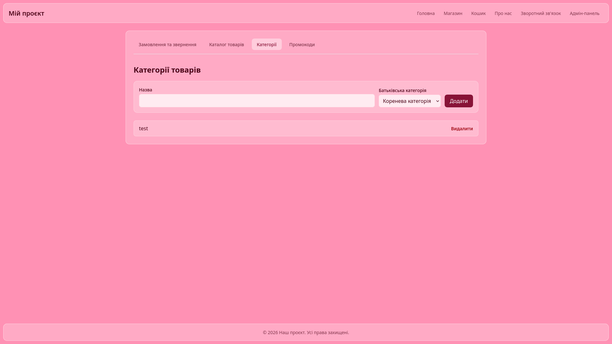

# Звіт до лабораторної роботи №4

## 1. Загальні відомості

- **ПІБ:** Засєкін Ілля
- **Група:** ІПЗ-22
- **Github:** [@NikanoNino](https://github.com/NikanoNino)
- **Тема проєкту:** Аніме мерч-магазин

**Посилання на репозиторій:** [GitHub](https://github.com/awaikoi/Lab4)

### Склад команди

| №   | ПІБ учасника    | GitHub                                             |
| --- | --------------- | -------------------------------------------------- |
| 1   | Ковтун Каріна   | [@k7912341-bit](https://github.com/k7912341-bit)   |
| 2   | Комарук Марк    |  [@ItsukiNikano](https://github.com/ItsukiNikano)  |
| 3   | Рудь Максим     | [@awaikoi](https://github.com/awaikoi)             |
| 4   | Шутовська Марта | [@YotsubaNikano](https://github.com/YotsubaNikano) |

---

## 2. Особистий внесок у командну роботу

1. Розроблено сторінку кошика покупок із відображенням доданих товарів, їхньої вартості, кількості та загальної суми замовлення. ([Коміт](https://github.com/awaikoi/Lab4/commit/3e64c77003cf74882f87561fa5c9a71bc5cfb2df))

2. Додано елементи керування кошиком: зміну кількості товарів і видалення окремих позицій. Також передбачено відображення порожнього кошика з посиланням на каталог товарів. ([Коміт](https://github.com/awaikoi/Lab4/commit/3e64c77003cf74882f87561fa5c9a71bc5cfb2df))

3. Створено форму оформлення замовлення з полями для введення електронної пошти та адреси доставки. Сторінку оформлено відповідно до загального шаблону сайту та інтегровано до основної гілки проєкту за допомогою Pull Request. ([Коміт](https://github.com/awaikoi/Lab4/commit/3e64c77003cf74882f87561fa5c9a71bc5cfb2df), [Злиття Pull Request](https://github.com/awaikoi/Lab4/commit/cc30d67eb56254ad61f153c03aae8a60343abd36))

**Список комітів:** [commits](https://github.com/awaikoi/Lab4/commits?author=NikanoNino)

---

## 3. Структура бази даних

### 3.1. Схема бази даних

### 3.1. Схема бази даних

База даних проєкту складається з шести таблиць, які забезпечують зберігання інформації про товари, категорії, замовлення, промокоди та відгуки користувачів.

### 3.2. Опис таблиць

| Назва таблиці | Призначення                                                   | Основні поля                                                                             |
| ------------- | ------------------------------------------------------------- | ---------------------------------------------------------------------------------------- |
| `categories`  | Зберігання категорій товарів та їх ієрархії.                  | `id`, `name`, `parent_id`                                                                |
| `products`    | Зберігання інформації про товари, ціни, знижки та зображення. | `id`, `name`, `price`, `category_id`, `discount_percent`, `image`                        |
| `orders`      | Зберігання інформації про оформлені замовлення.               | `id`, `email`, `address`, `total_price`, `status`, `promo_code`                          |
| `order_items` | Зберігання переліку товарів у кожному замовленні.             | `id`, `order_id`, `product_id`, `quantity`, `unit_price`                                 |
| `promocodes`  | Зберігання промокодів та умов їх застосування.                | `id`, `code`, `discount_percent`, `discount_amount`, `min_order`, `active`, `expires_at` |
| `feedback`    | Зберігання повідомлень та відгуків користувачів.              | `id`, `name`, `email`, `message`, `created_at`                                           |

### 3.3. Ключі та зв'язки

- **Первинні ключі (PK):** поле `id` у кожній таблиці.
- **Зовнішні ключі (FK):**
    - `products.category_id` → `categories.id`;
    - `categories.parent_id` → `categories.id`;
    - `order_items.order_id` → `orders.id`;
    - `order_items.product_id` → `products.id`.
- **Зв'язки між таблицями:**
    - `categories` — `products`: один до багатьох (1:N);
    - `categories` — `categories`: самозв'язок для вкладених категорій;
    - `orders` — `order_items`: один до багатьох (1:N);
    - `products` — `order_items`: один до багатьох (1:N).

**Примітка:** таблиці `promocodes` та `feedback` не мають зовнішніх ключів. Поле `orders.promo_code` зберігає використаний промокод, але формального зв'язку з таблицею `promocodes` немає.

---

## 4. Скріншоти адміністративної панелі

- 4.1. Головна сторінка адміністративної панелі

    

- 4.2. Керування товарами

    

- 4.3. Додаткові можливості
    - Промокоди

        

    - Категорії

        

---

## 5. Труднощі під час виконання роботи

1. Під час розробки сторінки кошика виникла потреба правильно відобразити інформацію про кожен товар: назву, ціну, кількість і проміжну вартість. Для цього було використано шаблонізатор Jinja2 та передбачено динамічне відображення даних.

2. Під час створення елементів керування кошиком потрібно було забезпечити коректне передавання даних для зміни кількості товарів і видалення позицій. Для цього було використано HTML-форми, пов’язані з відповідними маршрутами Flask.

3. Під час реалізації форми оформлення замовлення виникла необхідність узгодити її з наявною структурою сайту. Проблему було вирішено шляхом використання базового шаблону `base.html` та спільних стилів оформлення.

---

## 6. Висновки

У ході виконання лабораторної роботи було розроблено сторінку кошика покупок, яка забезпечує відображення доданих товарів, їхньої кількості та загальної вартості. Також було реалізовано елементи керування товарами в кошику, передбачено відображення порожнього кошика та створено форму оформлення замовлення. Під час роботи було закріплено навички використання Flask, Jinja2, HTML-форм і GitHub, а також отримано досвід командної розробки та інтеграції власних змін до спільного проєкту.
