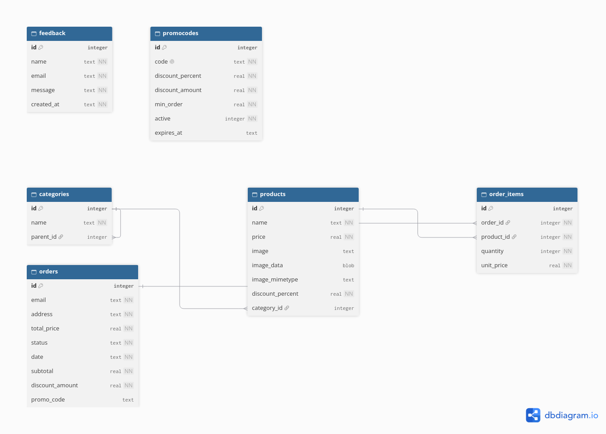
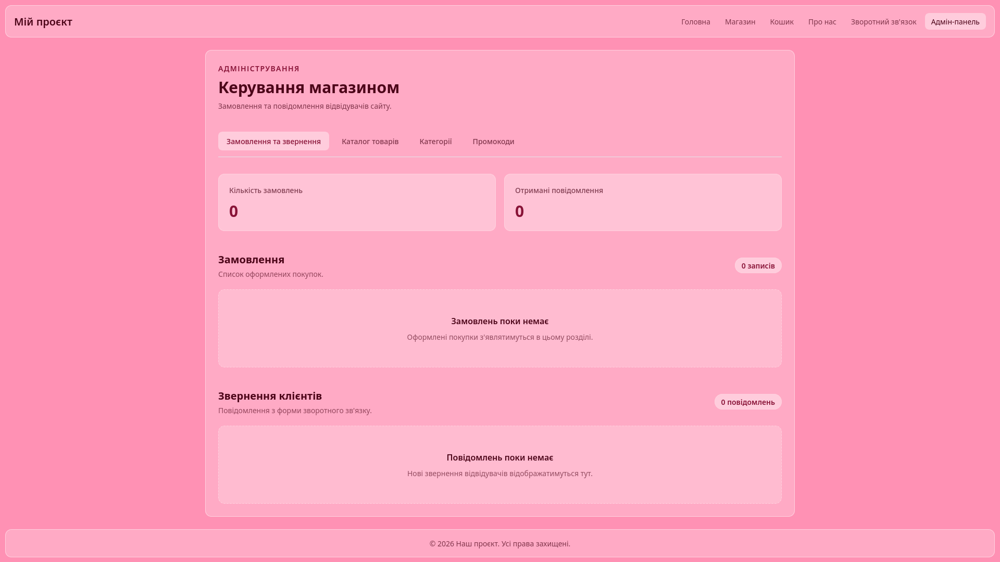
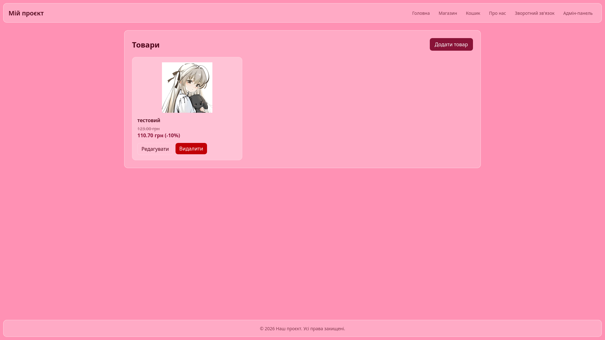
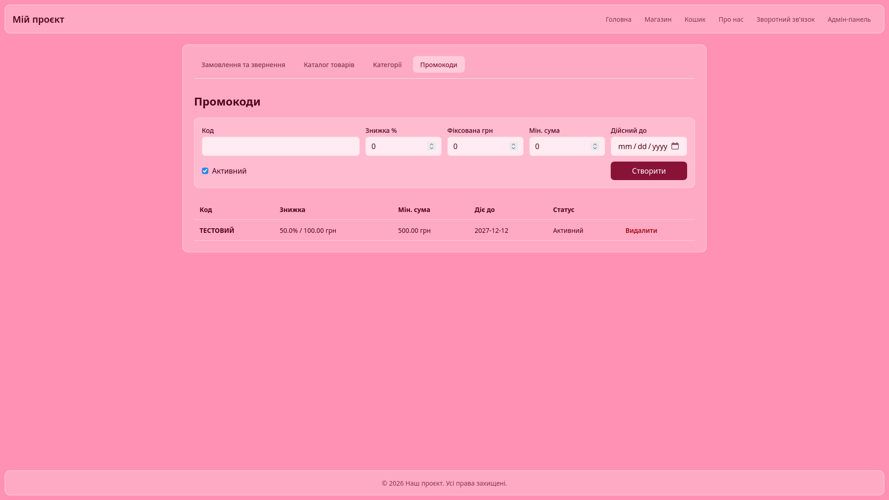
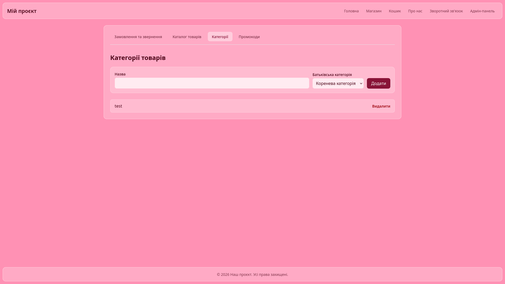

# Звіт до лабораторної роботи №4

## 1. Загальні відомості

- **ПІБ:** Ковтун Каріна 
- **Група:** ІПЗ-22
- **Github:** [@k7912341-bit](https://github.com/k7912341-bit)
- **Тема проєкту:** Аніме мерч-магазин

**Посилання на репозиторій:** [GitHub](https://github.com/awaikoi/Lab4)

### Склад команди

| №   | ПІБ учасника    | GitHub                                             |
| --- | --------------- | -------------------------------------------------- |
| 1   | Засєкін Ілля    | [@NikanoNino](https://github.com/NikanoNino)       |
| 2   | Комарук Марк    | [@ItsukiNikano](https://github.com/ItsukiNikano)   |
| 3   | Рудь Максим     | [@awaikoi](https://github.com/awaikoi)             |
| 4   | Шутовська Марта | [@YotsubaNikano](https://github.com/YotsubaNikano) |

---

## 2. Особистий внесок у командну роботу

1. Розроблено сторінку перегляду детальної інформації про замовлення в адміністративній панелі. Додано відображення номера замовлення, електронної пошти покупця, адреси доставки, загальної суми, статусу та дати оформлення. ([Коміт](https://github.com/awaikoi/Lab4/commit/443401c054cceda593bbbb34231e2929266e6a87))

2. Реалізовано відображення переліку товарів у замовленні у вигляді таблиці з назвами, цінами, кількістю та загальною вартістю кожної позиції. ([Коміт](https://github.com/awaikoi/Lab4/commit/443401c054cceda593bbbb34231e2929266e6a87))

3. Додано форму зміни статусу замовлення з можливістю вибору нового значення та його оновлення. Передбачено навігацію назад до списку замовлень. Сторінку інтегровано до основної гілки проєкту через Pull Request №11. ([Коміт](https://github.com/awaikoi/Lab4/commit/443401c054cceda593bbbb34231e2929266e6a87), [Злиття Pull Request](https://github.com/awaikoi/Lab4/commit/73d3737c58814665d273e3ebcd66d08d4af1db5a))

**Список комітів:** [commits](https://github.com/awaikoi/Lab4/commits?author=k7912341-bit)

---

## 3. Структура бази даних

### 3.1. Схема бази даних

### 3.1. Схема бази даних

База даних проєкту складається з шести таблиць, які забезпечують зберігання інформації про товари, категорії, замовлення, промокоди та відгуки користувачів.

### 3.2. Опис таблиць

| Назва таблиці | Призначення                                                   | Основні поля                                                                             |
| ------------- | ------------------------------------------------------------- | ---------------------------------------------------------------------------------------- |
| `categories`  | Зберігання категорій товарів та їх ієрархії.                  | `id`, `name`, `parent_id`                                                                |
| `products`    | Зберігання інформації про товари, ціни, знижки та зображення. | `id`, `name`, `price`, `category_id`, `discount_percent`, `image`                        |
| `orders`      | Зберігання інформації про оформлені замовлення.               | `id`, `email`, `address`, `total_price`, `status`, `promo_code`                          |
| `order_items` | Зберігання переліку товарів у кожному замовленні.             | `id`, `order_id`, `product_id`, `quantity`, `unit_price`                                 |
| `promocodes`  | Зберігання промокодів та умов їх застосування.                | `id`, `code`, `discount_percent`, `discount_amount`, `min_order`, `active`, `expires_at` |
| `feedback`    | Зберігання повідомлень та відгуків користувачів.              | `id`, `name`, `email`, `message`, `created_at`                                           |

### 3.3. Ключі та зв'язки

- **Первинні ключі (PK):** поле `id` у кожній таблиці.
- **Зовнішні ключі (FK):**
    - `products.category_id` → `categories.id`;
    - `categories.parent_id` → `categories.id`;
    - `order_items.order_id` → `orders.id`;
    - `order_items.product_id` → `products.id`.
- **Зв'язки між таблицями:**
    - `categories` — `products`: один до багатьох (1:N);
    - `categories` — `categories`: самозв'язок для вкладених категорій;
    - `orders` — `order_items`: один до багатьох (1:N);
    - `products` — `order_items`: один до багатьох (1:N).

**Примітка:** таблиці `promocodes` та `feedback` не мають зовнішніх ключів. Поле `orders.promo_code` зберігає використаний промокод, але формального зв'язку з таблицею `promocodes` немає.

---

## 4. Скріншоти адміністративної панелі

- 4.1. Головна сторінка адміністративної панелі

    

- 4.2. Керування товарами

    

- 4.3. Додаткові можливості
    - Промокоди

        

    - Категорії

        

---

## 5. Труднощі під час виконання роботи

1. Під час створення сторінки деталей замовлення виникла необхідність правильно відобразити всі пов'язані дані покупця та замовлення. Для цього було використано шаблонізатор Jinja2 та передбачено виведення інформації з відповідних об'єктів.

2. Під час формування таблиці товарів потрібно було забезпечити коректне відображення цін, кількості та вартості кожної позиції. Це було вирішено за допомогою циклів Jinja2 та обчислення вартості товарів на основі ціни й кількості.

3. Під час реалізації зміни статусу замовлення виникла потреба пов'язати форму з відповідним маршрутом адміністративної панелі. Для цього було використано HTML-форму з методом POST та динамічне формування адреси маршруту Flask.

---

## 6. Висновки

У ході виконання лабораторної роботи було створено сторінку детального перегляду замовлення в адміністративній панелі. Реалізовано відображення інформації про покупця, параметрів замовлення та переліку придбаних товарів. Також додано можливість зміни статусу замовлення. Під час роботи було закріплено навички використання Flask, Jinja2, HTML-форм і GitHub, а також отримано досвід інтеграції окремих компонентів у спільний вебпроєкт.
