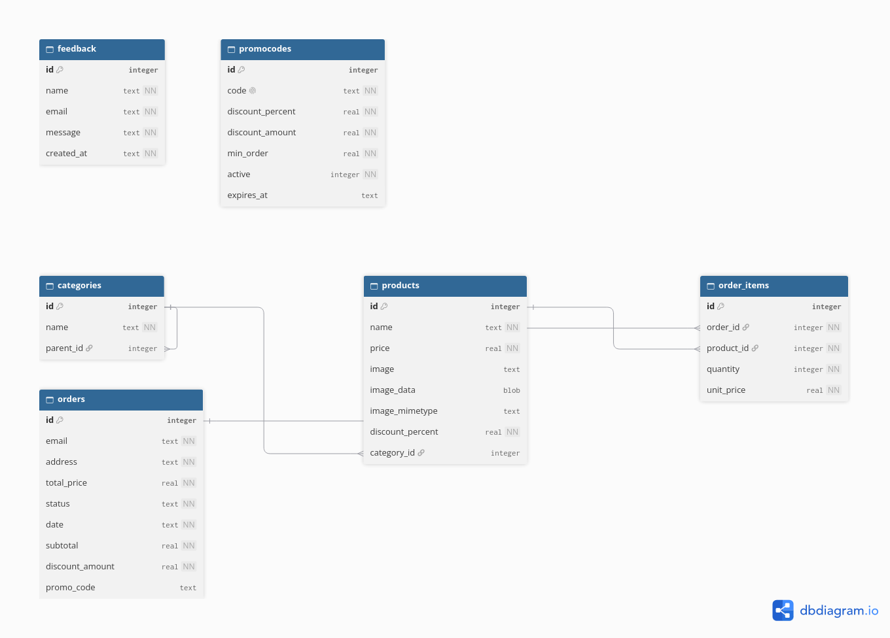
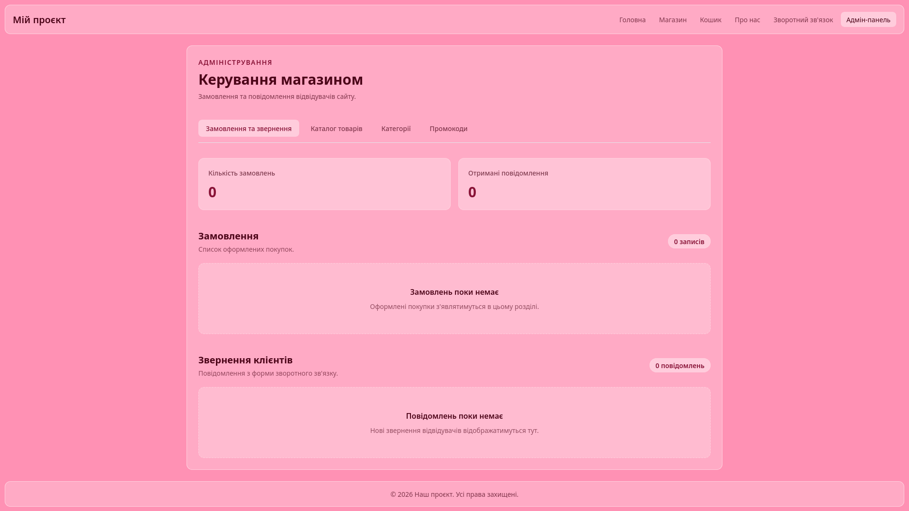
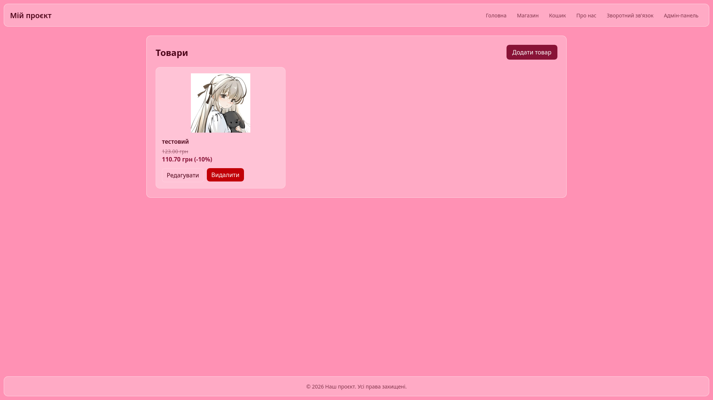
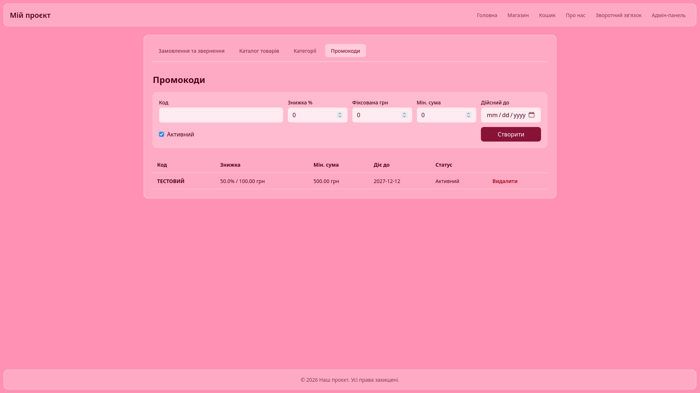
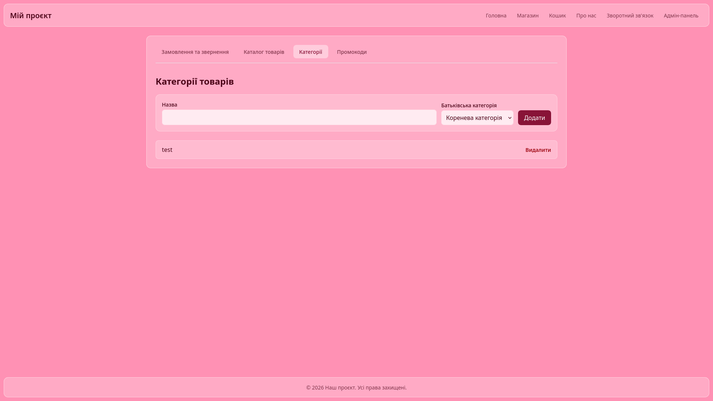

# Звіт до лабораторної роботи №4

## 1. Загальні відомості

- **ПІБ:** Комарук Марк 
- **Група:** ІПЗ-22
- **Github:** [@ItsukiNikano](https://github.com/ItsukiNikano)
- **Тема проєкту:** Аніме мерч-магазин

**Посилання на репозиторій:** [GitHub](https://github.com/awaikoi/Lab4)

### Склад команди

| №   | ПІБ учасника    | GitHub                                             |
| --- | --------------- | -------------------------------------------------- |
| 1   | Ковтун Каріна   | [@k7912341-bit](https://github.com/k7912341-bit)   |
| 2   | Засєкін Ілля    | [@NikanoNino](https://github.com/NikanoNino)       |
| 3   | Рудь Максим     | [@awaikoi](https://github.com/awaikoi)             |
| 4   | Шутовська Марта | [@YotsubaNikano](https://github.com/YotsubaNikano) |

---

## 2. Особистий внесок у командну роботу

1. Розроблено сторінку зворотного зв'язку (`feedback.html`) з формою для введення імені, електронної пошти та повідомлення користувача. ([Коміт](https://github.com/awaikoi/Lab4/commit/c32ee1ee54f42a070b30939eddbf573408cd4b77))

2. Реалізовано асинхронне надсилання форми без перезавантаження сторінки, обробку помилок і відображення модального вікна з повідомленням про успішне надсилання відгуку. ([Коміт](https://github.com/awaikoi/Lab4/commit/c32ee1ee54f42a070b30939eddbf573408cd4b77))

3. Внесено зміни до файлу бази даних `db.sqlite`, налаштовано `.gitignore` та інтегровано розроблену сторінку до основної гілки проєкту за допомогою Pull Request. ([Коміт](https://github.com/awaikoi/Lab4/commit/c32ee1ee54f42a070b30939eddbf573408cd4b77), [Злиття Pull Request](https://github.com/awaikoi/Lab4/commit/09b3767122e940f5c85c4893645a79561ec64ead))

**Список комітів:** [commits](https://github.com/awaikoi/Lab4/commits?author=ItsukiNikano)

---

## 3. Структура бази даних

### 3.1. Схема бази даних

### 3.1. Схема бази даних

База даних проєкту складається з шести таблиць, які забезпечують зберігання інформації про товари, категорії, замовлення, промокоди та відгуки користувачів.

### 3.2. Опис таблиць

| Назва таблиці | Призначення                                                   | Основні поля                                                                             |
| ------------- | ------------------------------------------------------------- | ---------------------------------------------------------------------------------------- |
| `categories`  | Зберігання категорій товарів та їх ієрархії.                  | `id`, `name`, `parent_id`                                                                |
| `products`    | Зберігання інформації про товари, ціни, знижки та зображення. | `id`, `name`, `price`, `category_id`, `discount_percent`, `image`                        |
| `orders`      | Зберігання інформації про оформлені замовлення.               | `id`, `email`, `address`, `total_price`, `status`, `promo_code`                          |
| `order_items` | Зберігання переліку товарів у кожному замовленні.             | `id`, `order_id`, `product_id`, `quantity`, `unit_price`                                 |
| `promocodes`  | Зберігання промокодів та умов їх застосування.                | `id`, `code`, `discount_percent`, `discount_amount`, `min_order`, `active`, `expires_at` |
| `feedback`    | Зберігання повідомлень та відгуків користувачів.              | `id`, `name`, `email`, `message`, `created_at`                                           |

### 3.3. Ключі та зв'язки

- **Первинні ключі (PK):** поле `id` у кожній таблиці.
- **Зовнішні ключі (FK):**
    - `products.category_id` → `categories.id`;
    - `categories.parent_id` → `categories.id`;
    - `order_items.order_id` → `orders.id`;
    - `order_items.product_id` → `products.id`.
- **Зв'язки між таблицями:**
    - `categories` — `products`: один до багатьох (1:N);
    - `categories` — `categories`: самозв'язок для вкладених категорій;
    - `orders` — `order_items`: один до багатьох (1:N);
    - `products` — `order_items`: один до багатьох (1:N).

**Примітка:** таблиці `promocodes` та `feedback` не мають зовнішніх ключів. Поле `orders.promo_code` зберігає використаний промокод, але формального зв'язку з таблицею `promocodes` немає.

---

## 4. Скріншоти адміністративної панелі

- 4.1. Головна сторінка адміністративної панелі

    

- 4.2. Керування товарами

    

- 4.3. Додаткові можливості
    - Промокоди

        

    - Категорії

        

---

## 5. Труднощі під час виконання роботи

1. Під час створення сторінки зворотного зв’язку виникла потреба узгодити її структуру та оформлення з основним шаблоном сайту `base.html`, щоб забезпечити єдиний стиль інтерфейсу.

2. Під час реалізації асинхронного надсилання форми виникли труднощі з обробкою відповідей сервера та помилок мережі без перезавантаження сторінки. Для їх вирішення було використано JavaScript Fetch API та передбачено відображення повідомлень про результат надсилання.

3. Під час інтеграції змін до основної гілки проєкту потрібно було перевірити сумісність доданої сторінки з наявною структурою проєкту та правильно об'єднати зміни за допомогою Pull Request.

---

## 6. Висновки

У ході виконання лабораторної роботи було розроблено сторінку зворотного зв’язку, створено форму для надсилання повідомлень та реалізовано її асинхронну обробку без перезавантаження сторінки. Також було додано відображення повідомлень про успішне надсилання та можливі помилки. Отримані результати допомогли закріпити навички роботи з Flask, HTML, JavaScript та GitHub, а також покращити розуміння процесу командної розробки й інтеграції змін у спільний проєкт.
