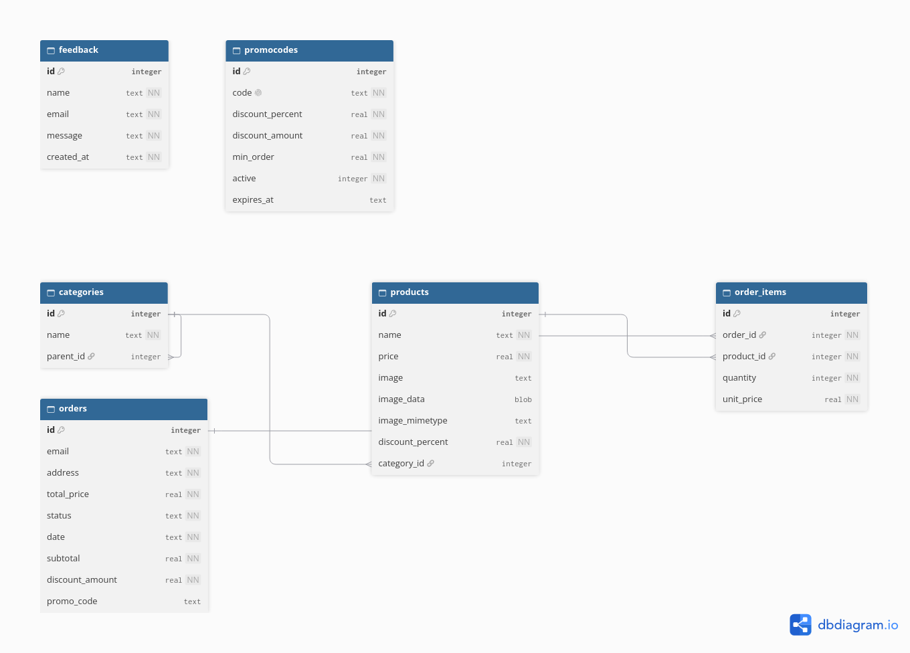
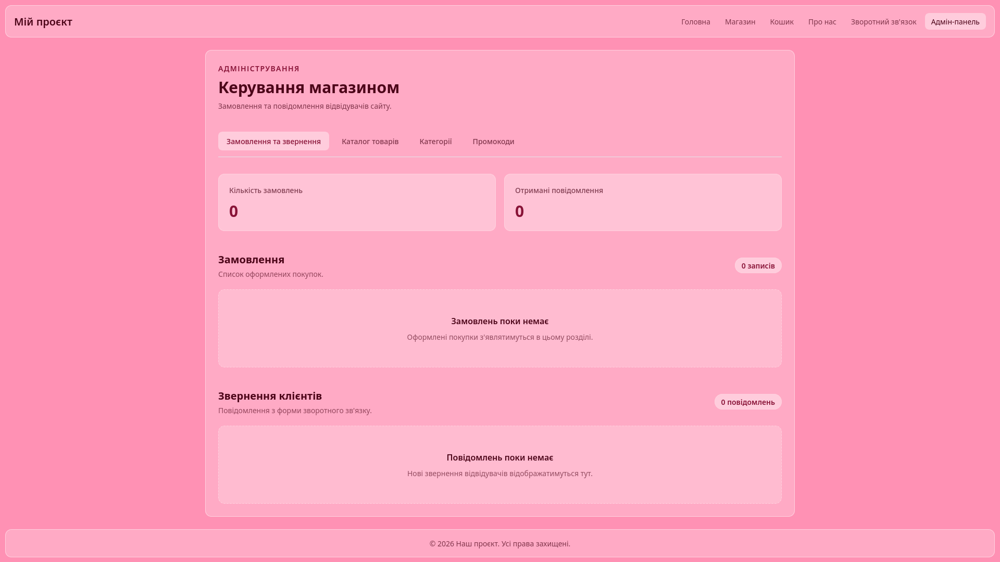
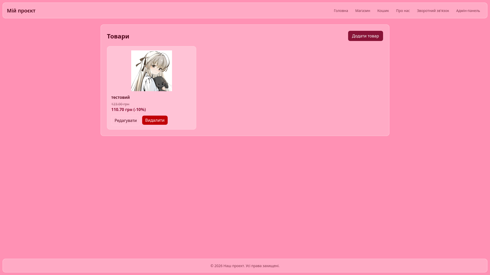
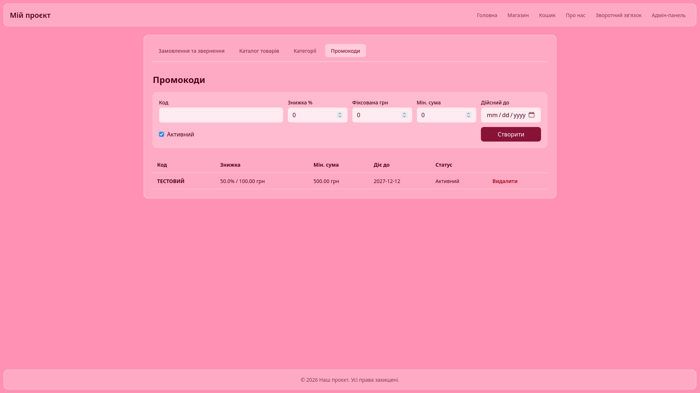
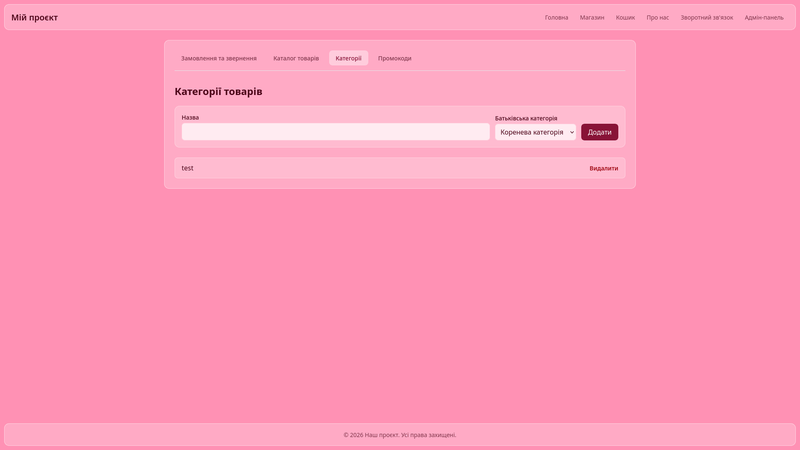

# Звіт до лабораторної роботи №4

## 1. Загальні відомості

- **ПІБ:** Рудь Максим
- **Група:** ІПЗ-22
- **Github:** [@awaikoi](https://github.com/awaikoi)
- **Тема проєкту:** Аніме мерч-магазин

**Посилання на репозиторій:** [GitHub](https://github.com/awaikoi/Lab4)

### Склад команди

| №   | ПІБ учасника    | GitHub                                             |
| --- | --------------- | -------------------------------------------------- |
| 1   | Ковтун Каріна   | [@k7912341-bit](https://github.com/k7912341-bit)   |
| 2   | Засєкін Ілля    | [@NikanoNino](https://github.com/NikanoNino)       |
| 3   | Комарук Марк    | [@ItsukiNikano](https://github.com/ItsukiNikano)   |
| 4   | Шутовська Марта | [@YotsubaNikano](https://github.com/YotsubaNikano) |

---

## 2. Особистий внесок у командну роботу

1. Створено початкову структуру Flask-застосунку, налаштовано базові маршрути, моделі бази даних, головну сторінку, каталог товарів та основні компоненти адміністративної панелі. ([Коміт](https://github.com/awaikoi/Lab4/commit/4aed5d09f10bfee4c9d4bebd2ca14d84426d797d))

2. Розроблено сторінку «Про нас», вдосконалено обробку помилок і повідомлень про успішні операції, додано перевірку форматів завантажуваних зображень товарів. ([Сторінка About](https://github.com/awaikoi/Lab4/commit/fecbab0a0a5e4f650c05b2f6e0b4ed85d4787223), [Обробка помилок](https://github.com/awaikoi/Lab4/commit/186524dfa325e3ba19d1a0c24a25e57b8d785fa4))

3. Реалізовано систему категорій товарів із підтримкою вкладеності, знижки та промокоди, пошук і фільтрацію товарів, а також відповідні зміни в кошику й адміністративній панелі. ([Коміт](https://github.com/awaikoi/Lab4/commit/ce0ac81117fff0f7da5e50cdd072738652734d3a))

**Список комітів:** [commits](https://github.com/awaikoi/Lab4/commits?author=awaikoi)

---

## 3. Структура бази даних

### 3.1. Схема бази даних

### 3.1. Схема бази даних

База даних проєкту складається з шести таблиць, які забезпечують зберігання інформації про товари, категорії, замовлення, промокоди та відгуки користувачів.

### 3.2. Опис таблиць

| Назва таблиці | Призначення                                                   | Основні поля                                                                             |
| ------------- | ------------------------------------------------------------- | ---------------------------------------------------------------------------------------- |
| `categories`  | Зберігання категорій товарів та їх ієрархії.                  | `id`, `name`, `parent_id`                                                                |
| `products`    | Зберігання інформації про товари, ціни, знижки та зображення. | `id`, `name`, `price`, `category_id`, `discount_percent`, `image`                        |
| `orders`      | Зберігання інформації про оформлені замовлення.               | `id`, `email`, `address`, `total_price`, `status`, `promo_code`                          |
| `order_items` | Зберігання переліку товарів у кожному замовленні.             | `id`, `order_id`, `product_id`, `quantity`, `unit_price`                                 |
| `promocodes`  | Зберігання промокодів та умов їх застосування.                | `id`, `code`, `discount_percent`, `discount_amount`, `min_order`, `active`, `expires_at` |
| `feedback`    | Зберігання повідомлень та відгуків користувачів.              | `id`, `name`, `email`, `message`, `created_at`                                           |

### 3.3. Ключі та зв'язки

- **Первинні ключі (PK):** поле `id` у кожній таблиці.
- **Зовнішні ключі (FK):**
    - `products.category_id` → `categories.id`;
    - `categories.parent_id` → `categories.id`;
    - `order_items.order_id` → `orders.id`;
    - `order_items.product_id` → `products.id`.
- **Зв'язки між таблицями:**
    - `categories` — `products`: один до багатьох (1:N);
    - `categories` — `categories`: самозв'язок для вкладених категорій;
    - `orders` — `order_items`: один до багатьох (1:N);
    - `products` — `order_items`: один до багатьох (1:N).

**Примітка:** таблиці `promocodes` та `feedback` не мають зовнішніх ключів. Поле `orders.promo_code` зберігає використаний промокод, але формального зв'язку з таблицею `promocodes` немає.

---

## 4. Скріншоти адміністративної панелі

- 4.1. Головна сторінка адміністративної панелі

    

- 4.2. Керування товарами

    

- 4.3. Додаткові можливості
    - Промокоди

        

    - Категорії

        

---

## 5. Труднощі під час виконання роботи

| №   | Проблема                                                                                  | Спосіб вирішення                                                                        |
| --- | ----------------------------------------------------------------------------------------- | --------------------------------------------------------------------------------------- |
| 1   | Виникли труднощі з реалізацією та налаштуванням функціоналу керування товарами.           | Було вдосконалено адміністративну панель та обробку операцій із товарами.               |
| 2   | Під час розробки інтерфейсу виникла потреба узгодити оформлення різних сторінок магазину. | Було використано спільний базовий шаблон та уніфіковано структуру сторінок.             |
| 3   | Виникли труднощі з інтеграцією нових функцій у наявну структуру проєкту.                  | Новий функціонал поступово інтегрувався в наявний код із перевіркою його сумісності.    |
| 4   | Під час командної роботи виникали конфлікти змін у файлах проєкту.                        | Для синхронізації роботи використовували Git, окремі гілки та злиття змін через GitHub. |

---

## 6. Висновки

У результаті виконання лабораторної роботи було вдосконалено веб-застосунок інтернет-магазину, реалізовано додаткові функції для роботи з товарами, замовленнями та адміністративною панеллю. Під час роботи було отримано практичний досвід командної розробки, роботи з базами даних, Flask та системою контролю версій Git. Також було покращено навички інтеграції нових функцій у вже наявний проєкт.
