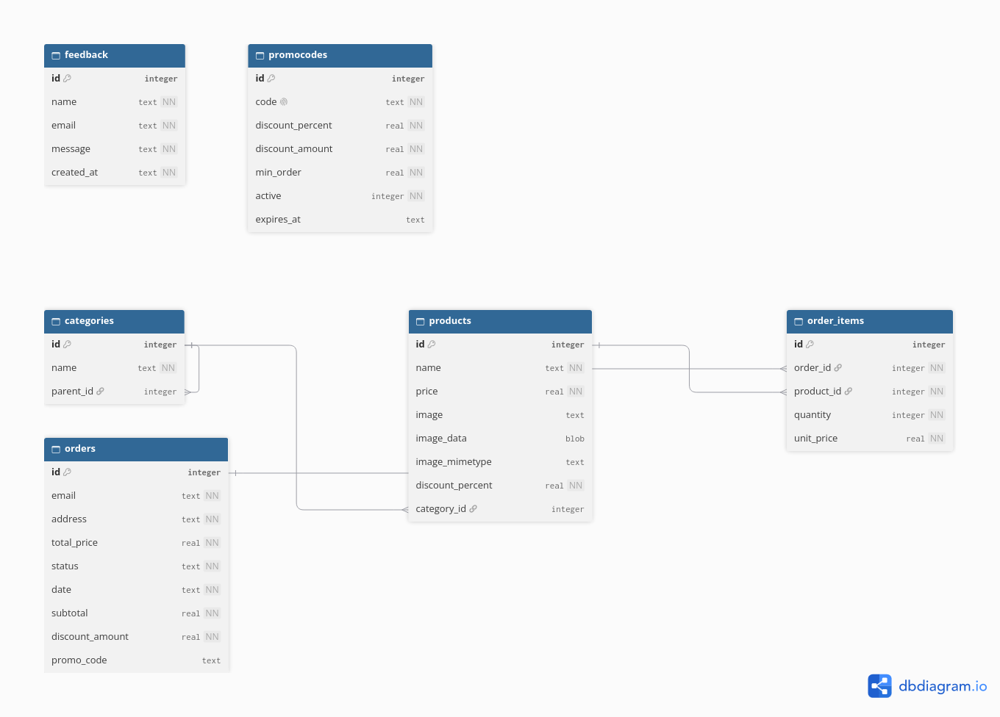
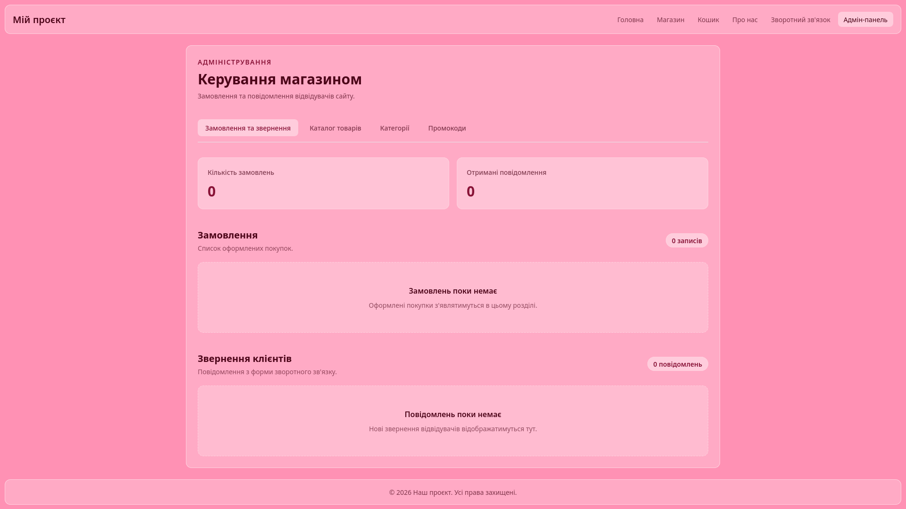
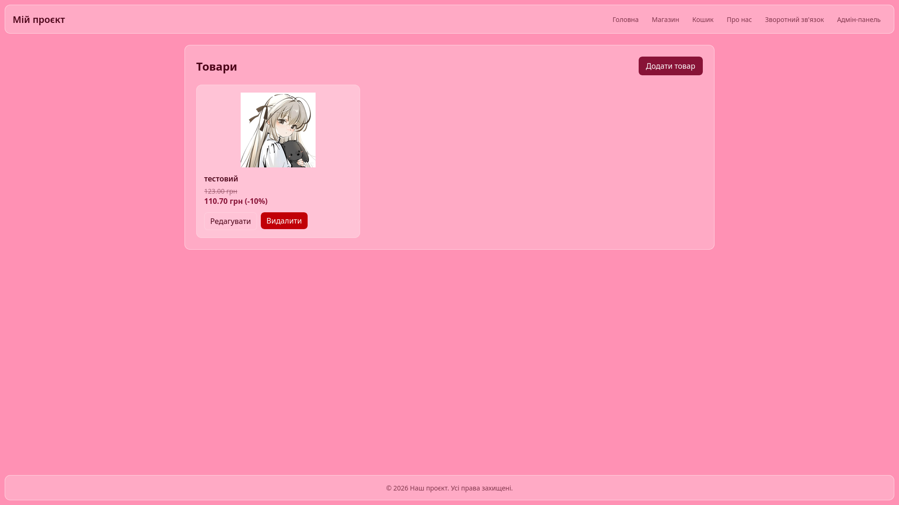
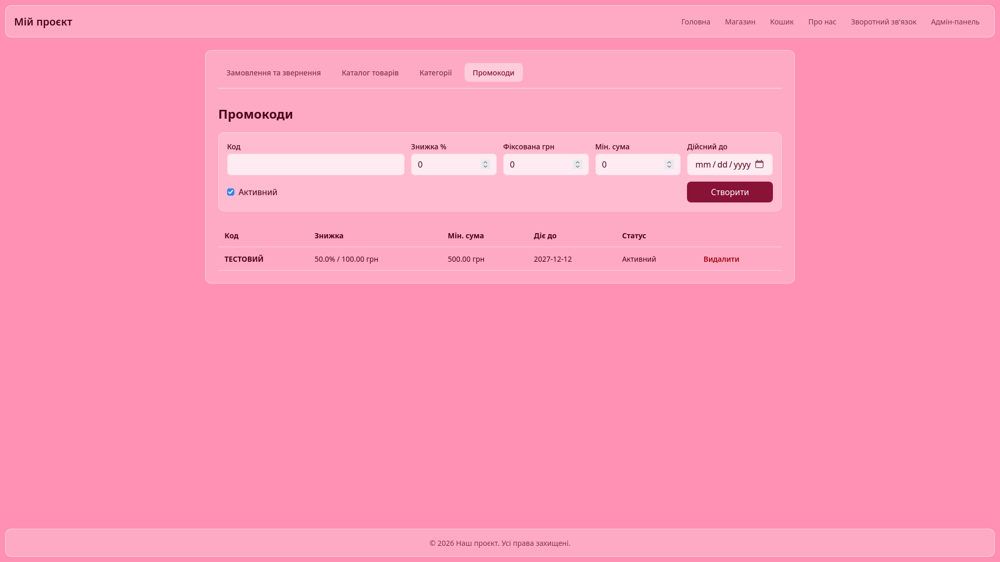
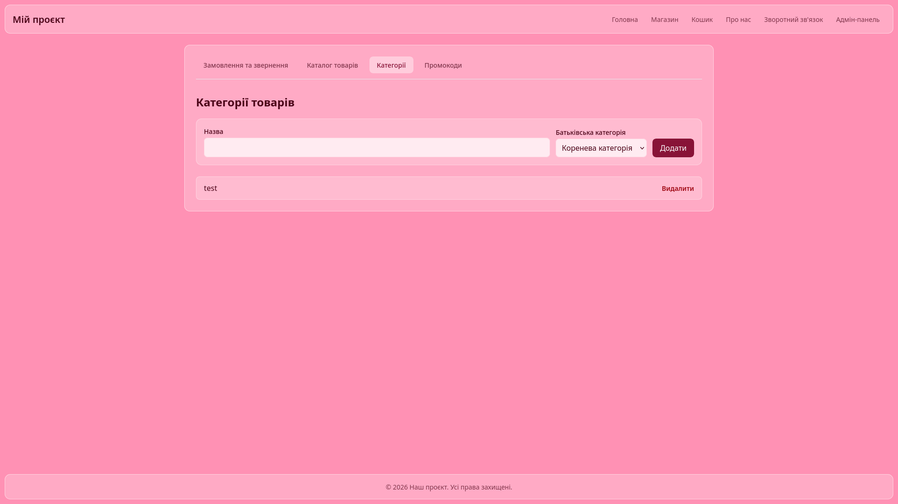

# Звіт до лабораторної роботи №4

## 1. Загальні відомості

- **ПІБ:** Шутовська Марта
- **Група:** ІПЗ-22
- **Github:** [@YotsubaNikano](https://github.com/YotsubaNikano)
- **Тема проєкту:** Аніме мерч-магазин

**Посилання на репозиторій:** [GitHub](https://github.com/awaikoi/Lab4)

### Склад команди

| №   | ПІБ учасника    | GitHub                                             |
| --- | --------------- | -------------------------------------------------- |
| 1   | Засєкін Ілля    | [@NikanoNino](https://github.com/NikanoNino)       |
| 2   | Комарук Марк    | [@ItsukiNikano](https://github.com/ItsukiNikano)   |
| 3   | Рудь Максим     | [@awaikoi](https://github.com/awaikoi)             |
| 4   | Ковтун Каріна   | [@k7912341-bit](https://github.com/k7912341-bit)   |

---

## 2. Особистий внесок у командну роботу

1. Розроблено сторінку адміністративної панелі для керування магазином із відображенням загальної кількості замовлень та повідомлень від користувачів.
2. Реалізовано таблицю замовлень із відображенням інформації про покупців, суми, статуси та дати оформлення. Додано можливість переходу до деталей і видалення замовлень.
3. Створено блок для перегляду та видалення повідомлень зі сторінки зворотного зв’язку. Розроблено спільні макроси для навігації адміністратора та відображення статусів замовлень.

**Список комітів:** [commits](https://github.com/awaikoi/Lab4/commits?author=YotsubaNikano)

---

## 3. Структура бази даних

### 3.1. Схема бази даних

### 3.1. Схема бази даних

База даних проєкту складається з шести таблиць, які забезпечують зберігання інформації про товари, категорії, замовлення, промокоди та відгуки користувачів.

### 3.2. Опис таблиць

| Назва таблиці | Призначення                                                   | Основні поля                                                                             |
| ------------- | ------------------------------------------------------------- | ---------------------------------------------------------------------------------------- |
| `categories`  | Зберігання категорій товарів та їх ієрархії.                  | `id`, `name`, `parent_id`                                                                |
| `products`    | Зберігання інформації про товари, ціни, знижки та зображення. | `id`, `name`, `price`, `category_id`, `discount_percent`, `image`                        |
| `orders`      | Зберігання інформації про оформлені замовлення.               | `id`, `email`, `address`, `total_price`, `status`, `promo_code`                          |
| `order_items` | Зберігання переліку товарів у кожному замовленні.             | `id`, `order_id`, `product_id`, `quantity`, `unit_price`                                 |
| `promocodes`  | Зберігання промокодів та умов їх застосування.                | `id`, `code`, `discount_percent`, `discount_amount`, `min_order`, `active`, `expires_at` |
| `feedback`    | Зберігання повідомлень та відгуків користувачів.              | `id`, `name`, `email`, `message`, `created_at`                                           |

### 3.3. Ключі та зв'язки

- **Первинні ключі (PK):** поле `id` у кожній таблиці.
- **Зовнішні ключі (FK):**
    - `products.category_id` → `categories.id`;
    - `categories.parent_id` → `categories.id`;
    - `order_items.order_id` → `orders.id`;
    - `order_items.product_id` → `products.id`.
- **Зв'язки між таблицями:**
    - `categories` — `products`: один до багатьох (1:N);
    - `categories` — `categories`: самозв'язок для вкладених категорій;
    - `orders` — `order_items`: один до багатьох (1:N);
    - `products` — `order_items`: один до багатьох (1:N).

**Примітка:** таблиці `promocodes` та `feedback` не мають зовнішніх ключів. Поле `orders.promo_code` зберігає використаний промокод, але формального зв'язку з таблицею `promocodes` немає.

---

## 4. Скріншоти адміністративної панелі

- 4.1. Головна сторінка адміністративної панелі

    

- 4.2. Керування товарами

    

- 4.3. Додаткові можливості
    - Промокоди

        

    - Категорії

        

---

## 5. Труднощі під час виконання роботи

1. **Організація відображення великої кількості даних.** Під час створення адміністративної панелі виникла необхідність зручно розмістити інформацію про замовлення та звернення клієнтів. Проблему вирішено за допомогою таблиць, карток і циклів Jinja2.
2. **Повторне використання елементів інтерфейсу.** Для уникнення дублювання коду було створено макроси Jinja2, які забезпечують спільну навігацію та відображення статусів замовлень.
3. **Обробка різних станів даних.** Потрібно було врахувати ситуації, коли замовлення або повідомлення відсутні. Для цього реалізовано умовні конструкції Jinja2 з відповідними повідомленнями.

---

## 6. Висновки

Під час виконання завдання було розроблено адміністративну панель інтернет-магазину, яка дозволяє переглядати замовлення та звернення користувачів, ознайомлюватися з основною інформацією й виконувати видалення записів. Також було створено повторно використовувані макроси для спрощення структури шаблонів. У результаті отримано практичні навички роботи з Flask, Jinja2, HTML та GitHub.
